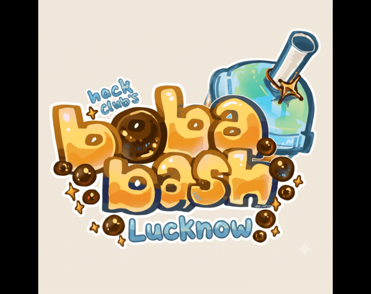
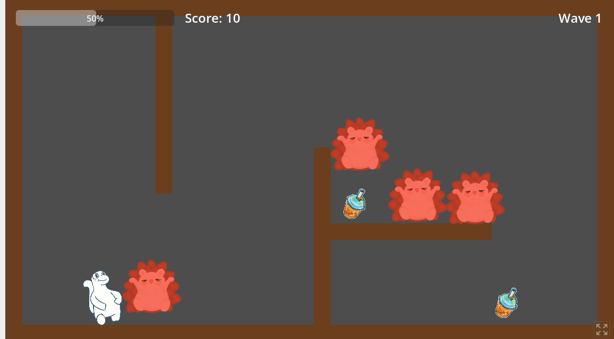

  

# Bobascape :3

A top-down wave survival game made in Godot 4.7. Orpheus fights off waves of Daven, dashes through danger, and grabs boba to heal and speed up. hehe

**Play it:** [https://saurabhcodesawfully.itch.io/bobascape]

## Screenshots

  
  

  

## Controls
- Move: [WASD / arrows]
- Attack: [key]
- Dash: [key]
- Restart after Game Over: R

## Gameplay
- Endless waves that get bigger, faster and tougher
- Boba pickups restore 25 health and give a short speed boost
- Score: 10 per kill, 5 per boba

## Run it locally
1. Install [Godot 4.7](https://godotengine.org/download)
2. Clone this repo and open `project.godot` in Godot
3. Press F5

## Credits
Code and game design by Saurabh Tiwari. Art assets were generated with AI tools.
Made for Boba Bash Lucknow by Hack Club. :3

## License
MIT
